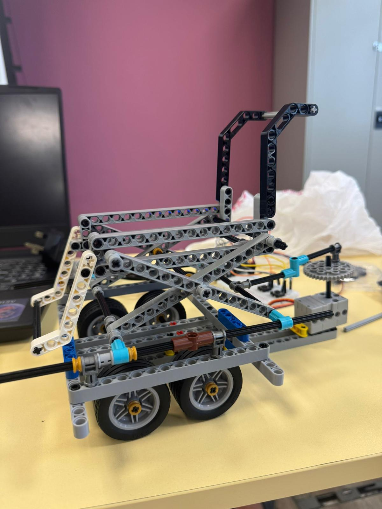
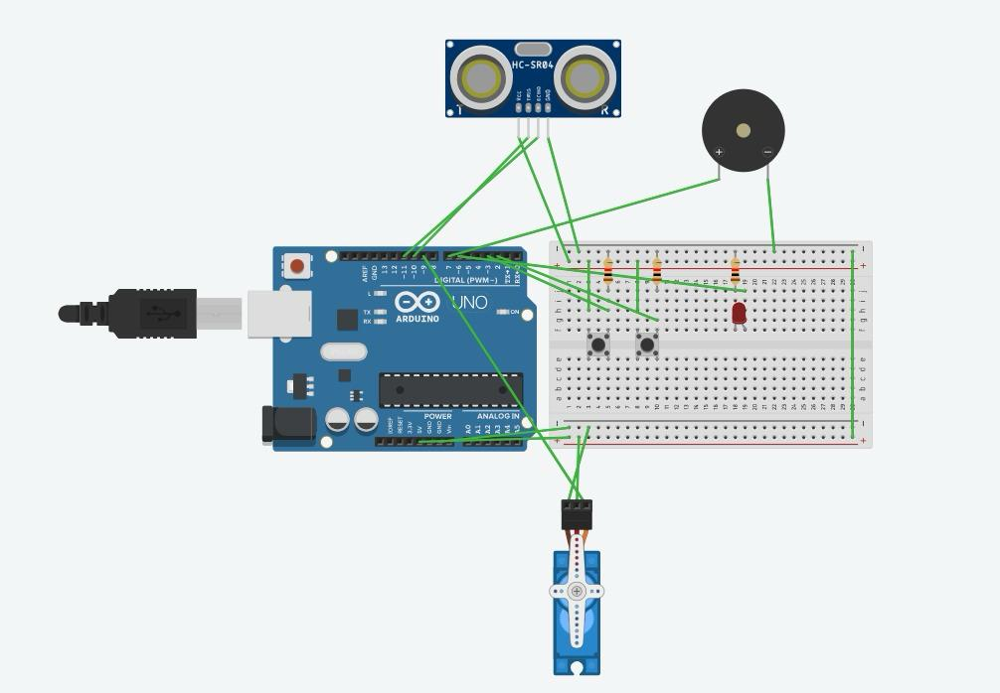
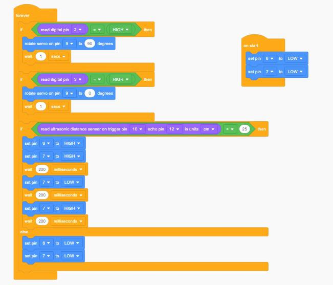
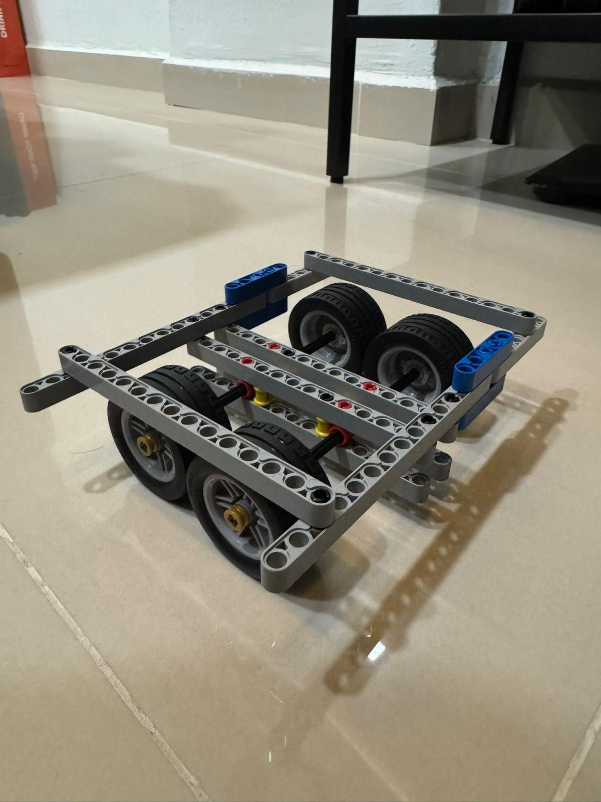
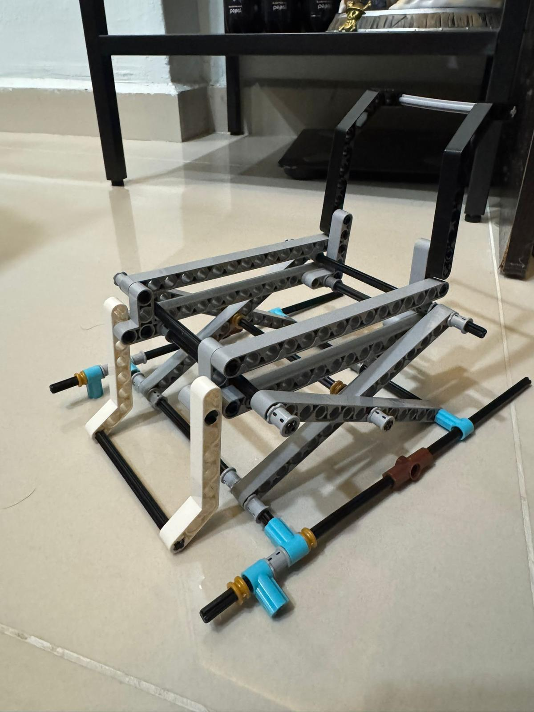
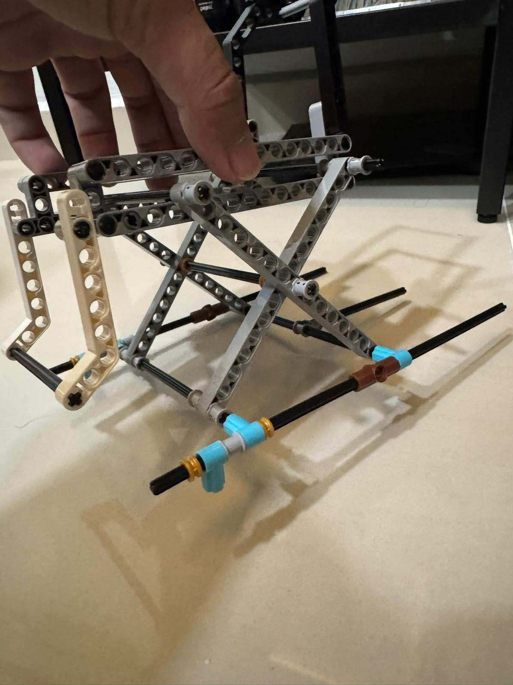
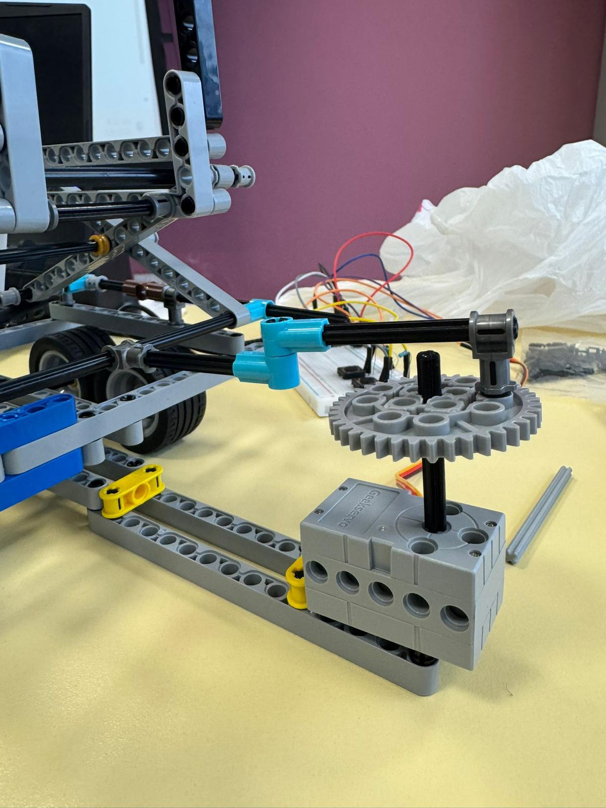

# Smart Elevating Wheelchair

A team prototype of a manual wheelchair with a **push-button seat lift** and a **rear obstacle warning**, built with an Arduino Uno and Lego Technic. It was made to help wheelchair users reach things placed too high, like supermarket shelves or MRT card readers, without needing help.

## 🎥 Demo videos

| Demo 1 | Demo 2 | Demo 3 |
|---|---|---|
| [▶️ Buttons on the breadboard driving the lift](docs/videos/demo-1.mp4) | [▶️ The scissor lift moving](docs/videos/demo-2.mp4) | [▶️ Seat rising, side view](docs/videos/demo-3.mp4) |

## Problem

Tommy Tan, a wheelchair user, faces accessibility and safety challenges during grocery trips, making independent trips difficult and discouraging.

**How might we** use smart technology to improve the physical reach and independence of wheelchair users in daily tasks like shopping?

Why it matters:

- **Physical strain:** reaching upwards from a low seat causes discomfort and can lead to long-term strain on the shoulders, neck and back.
- **Emotional impact:** facing barriers in everyday tasks affects confidence and dignity, and some users avoid going out altogether.
- **Limited reach:** many public spaces are not designed with seated users in mind.

## Ideas we considered

| Idea | What it does |
|---|---|
| Buzzer on the wheelchair | Alerts nearby staff that the user needs help |
| Smart app | Sends supermarket staff a notification to come and help |
| **Smart elevating wheelchair** ✅ | Raises the seat so the user can reach high items themselves |
| Extendable arm tool | A foldable grabber for items out of reach |

On our value-effort map, the elevating wheelchair gave users the most value, so we built it.

## How it works

| Feature | How it works |
|---|---|
| **Seat elevation** | Press one button to raise the seat and the other to lower it. A servo motor turns a Lego gear, which drives a scissor lift under the seat. |
| **Obstacle warning** | An ultrasonic sensor faces backwards. When something is closer than **25 cm**, an LED lights up and a buzzer beeps, because users can't always see behind them, especially with the seat raised. |

Compared with commercial standing or elevating wheelchairs (Levo LCEV, PDG Elevation), ours adds obstacle detection and a warning system, while keeping a simple manual wheelchair that needs no motorised driving training and stays low-cost.

## Hardware

| Part | Role |
|---|---|
| Arduino Uno | Controller |
| 2 push buttons + pull-down resistors | Seat up / seat down |
| Servo motor (Geekservo, Lego-compatible) | Turns the gear that drives the scissor lift |
| HC-SR04 ultrasonic sensor | Detects obstacles behind the wheelchair |
| LED + resistor | Visual warning |
| Piezo buzzer | Audible warning |
| Lego Technic | Wheelchair base, leg rest, scissor lift and gear drive |

### Wiring

| Arduino pin | Connected to |
|---|---|
| D2 | Seat **up** button (reads HIGH when pressed) |
| D3 | Seat **down** button (reads HIGH when pressed) |
| D6 | LED (on while an obstacle is close) |
| D7 | Buzzer (beeps while an obstacle is close) |
| D9 | Servo signal |
| D10 | HC-SR04 trigger |
| D12 | HC-SR04 echo |
| 5V, GND | Breadboard power rails |

| Tinkercad circuit | Block program |
|---|---|
|  |  |

## Code

The program was built with Tinkercad Circuits blocks. [`firmware/smart_wheelchair/smart_wheelchair.ino`](firmware/smart_wheelchair/smart_wheelchair.ino) is the same logic written as Arduino C++, so it can be uploaded from the Arduino IDE (it needs the built-in **Servo** library):

1. If the up button (D2) is pressed, turn the servo to 90° and wait 1 s.
2. If the down button (D3) is pressed, turn the servo to 0° and wait 1 s.
3. If the ultrasonic sensor reads less than 25 cm, turn the LED on and beep the buzzer. Otherwise turn both off.

## Build process

| Wheelchair base | Scissor lift (lowered) | Scissor lift (raised) | Servo and gear drive |
|---|---|---|---|
|  |  |  |  |

1. **Base:** a Lego frame on four wheels, for a stable base like a real wheelchair when the seat is raised.
2. **Leg rest** at the front.
3. **Scissor lift:** a linkage under the seat that raises it vertically.
4. **Gear drive:** the servo turns a gear that transfers torque to the rod that moves the lift.
5. **Electronics:** buttons, ultrasonic sensor, LED and buzzer on a breadboard, wired to the Arduino.

## Challenges and fixes

| Challenge | Fix | Result |
|---|---|---|
| The scissor lift was too stiff and stopped midway. | Adjusted the joint alignment for smoother movement. | The lift runs smoothly and no longer stops midway, so it is more dependable and safer. |
| The ultrasonic sensor picked up objects too far away to matter. | Added a software filter: only distances under 25 cm count. | Warnings only trigger for obstacles close to the wheelchair, so detection is more accurate and consistent. |

## Key takeaways

- **User-centred design:** understanding real challenges faced by wheelchair users shaped practical, meaningful features.
- **Testing and feedback:** testing with real-life scenarios surfaced problems early, so we could fix them.
- **Creativity vs. practicality:** knowing when to hold back on features kept the design simple and effective.

## Possible improvements

- Voice commands to control the system for users with limited hand function
- An app to adjust seat height, a night light and sensor settings
- An automatic brake against the front wheels while elevated
- Seat pressure sensors that warn when the user's posture is unsafe

## Team

Built as a group project (Group 1) by Liaw Wei Tak, Jaden Chua, Justin Cho and Praga.
